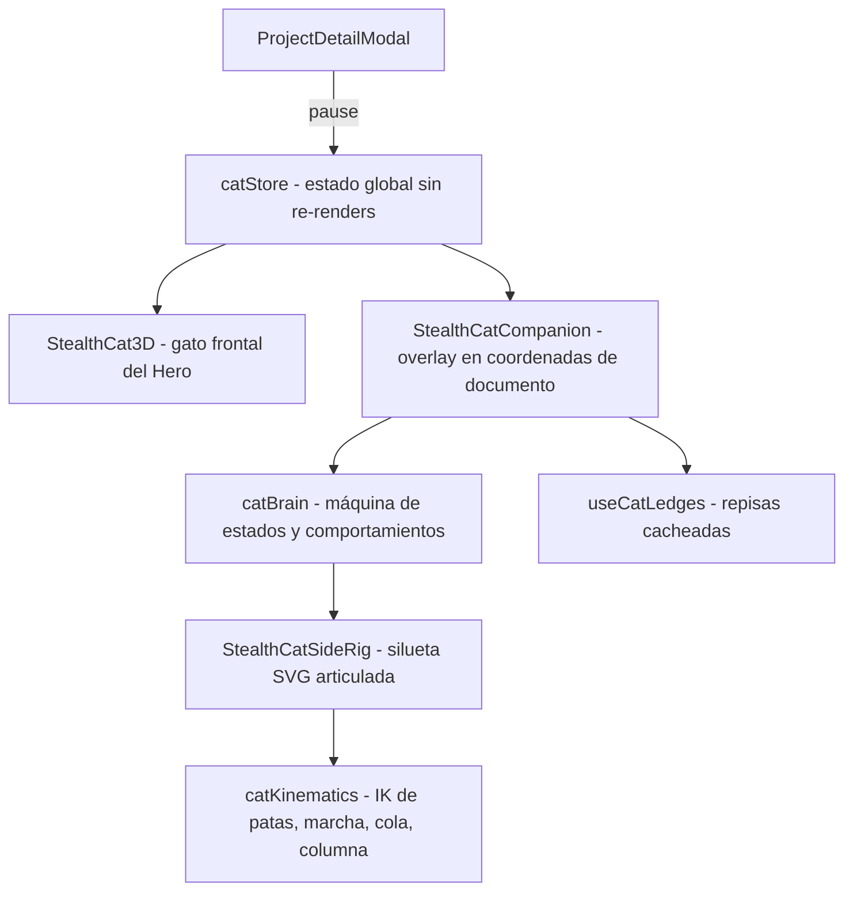
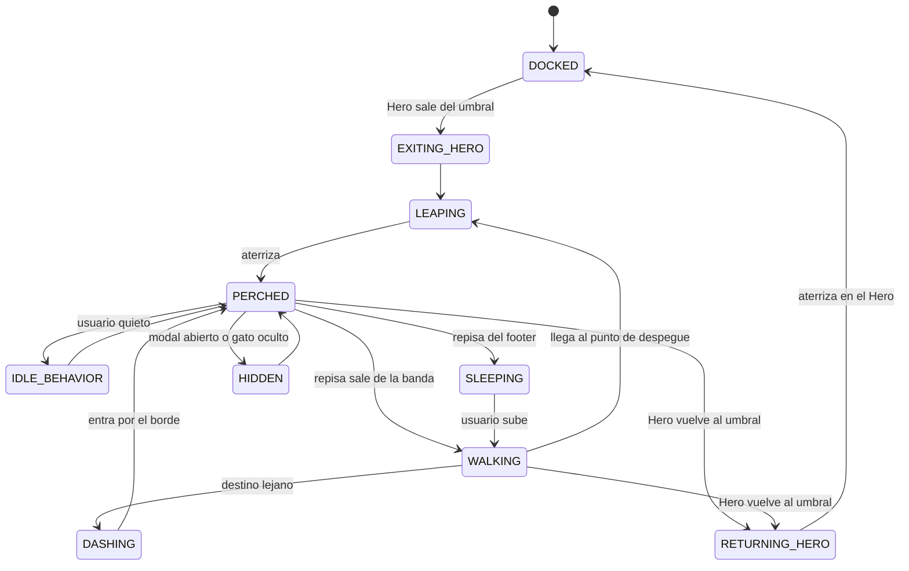

# 🐾 Plan Maestro: Stealth Cat Scroll Companion

> **Documento de Diseño Técnico & Creativo** — v2 (revisado)
> **Ubicación:** `apps/portfolio-v2/plans/stealth-cat-scroll-companion-plan.md`
> **Fecha:** Octubre 2026

---

## 0. Decisiones tomadas

| Tema | Decisión |
| :--- | :--- |
| Estilo visual del gato lateral | **Silueta orgánica de gato negro** (no rig "cyber" con placas). Prioriza que el *movimiento* se lea como un gato real. |
| Relación con el gato del Hero | **Sale del Hero** al hacer scroll (el hueco queda vacío) y **vuelve a su sitio** al subir. |
| Móvil / tablet | **Desactivado** (`< 1024px` o `pointer: coarse`). El gato del Hero sigue igual. |
| Flujo de trabajo | Primero un **Cat Lab** (banco de pruebas) para afinar animaciones antes de integrarlo en la página. |

---

## 1. Visión

Cuando el Hero sale de pantalla, el gato salta fuera de su tarjeta y se convierte en un **compañero de navegación de perfil, en 4 patas**, que:

1. Camina, trota o corre según cuánto se desplaza el usuario, con una marcha felina real.
2. Usa títulos y tarjetas del portfolio como **repisas físicas**: se posa sobre ellas, se desplaza con ellas al hacer scroll y salta a la siguiente cuando la actual sale de pantalla.
3. Cuando el usuario se detiene, **vive**: se sienta, se lame, bosteza, se estira, mueve la cola, mira el cursor.
4. En el footer se echa en **pancito (loaf)** y duerme respirando lento.
5. Al volver arriba, regresa corriendo y salta de vuelta a su sitio en el Hero.

Todo 100 % visual, sin burbujas de texto.

---

## 2. Dirección visual: silueta

### Por qué silueta
- Las formas del mismo color **se fusionan sin costuras**: patas, torso, cabeza y cola pueden ser piezas independientes superpuestas que se ven como un solo cuerpo. Esto hace el rig mucho más simple y robusto que uno con placas y contornos.
- El ojo humano reconoce a un gato por su **silueta y su forma de moverse**, no por sus detalles. Una silueta bien animada se ve más "real" que un dibujo detallado mal animado.

### Especificación
- **Relleno:** `#111111` (mismo negro del texto del portfolio).
- **Ojos:** almendras lima `#D4F014` muy pequeñas, con parpadeo. Único acento de color (mantiene el vínculo con la marca y con el gato del Hero).
- **Borde de luz (rim light) en fondos oscuros:** el Hero (`bg` oscuro) y el Footer (`#contacto`, oscuro) harían invisible la silueta. Cuando el gato está sobre una zona oscura, se activa un trazo sutil (`stroke` 1.25px, `rgba(212,240,20,0.55)` o neutro `#3a3a3a`) con transición de 200ms. Cada repisa declara su fondo (`data-cat-surface="dark|light"`).
- **Proporciones de gato real** (unidad = longitud del torso, `L`):
  - Altura a la cruz ≈ `0.55 L` · Cabeza ≈ `0.28 L` · Cola ≈ `0.9–1.0 L` · Patas traseras visiblemente más largas y anguladas que las delanteras.
- **Tamaño en pantalla:** ~130px de largo (sin cola) en desktop. Configurable en el Cat Lab.
- **Sin** placas, reactores, láser ni nariz `>`; esos elementos quedan solo en el gato frontal del Hero.

---

## 3. Arquitectura



### Archivos

| Archivo | Rol |
| :--- | :--- |
| `src/cat/catStore.ts` | Store mínimo (`useSyncExternalStore`): `mode` (`docked`/`roaming`/`returning`), `paused`, `dismissed`. Evita re-renders de React en cascada. |
| `src/cat/catKinematics.ts` | Matemática pura y testeable: IK de 2 huesos, ciclo de marcha, trayectorias de pie, cadena de cola, curva de columna, curvas de easing. |
| `src/cat/catBrain.ts` | Máquina de estados + programador de comportamientos de reposo. Sin React. |
| `src/cat/StealthCatSideRig.tsx` | El SVG. Se monta una vez; en cada frame solo se actualizan atributos vía refs. |
| `src/cat/useCatLedges.ts` | Registro y medición de repisas (`data-cat-ledge`). |
| `src/cat/StealthCatCompanion.tsx` | Overlay + bucle RAF único; conecta brain, ledges y rig. |
| `src/cat/CatLab.tsx` | Banco de pruebas solo en desarrollo (`?catlab`). |
| `src/components/StealthCat3D.tsx` | Cambios mínimos: atributo `data-cat-home`, suscripción a `catStore` para ocultarse/reaparecer con animación de salida/aterrizaje. |

> `Hero.tsx` **no se modifica**. Los demás componentes de sección solo reciben atributos `data-cat-*`.

---

## 4. Rig de la silueta (`StealthCatSideRig`)

Jerarquía (orden de pintado de atrás hacia adelante):

1. **Patas lejanas** (izquierdas): mismo color con `opacity: 0.85` para sugerir profundidad sin romper la silueta.
2. **Cola:** cadena de 10 segmentos renderizada como un `path` afilado (ancho decreciente de base a punta).
3. **Torso:** se define por dos puntos, **pelvis** y **pecho**; la columna es una Bézier entre ambos, lo que permite **arquear** (estiramiento, susto) y **encorvar** (agachado, loaf). El contorno del torso se genera a partir de esa curva (vientre + lomo).
4. **Omóplato:** pequeña protuberancia sobre el pecho que **sube cuando la pata delantera cercana está apoyada**. Es uno de los rasgos que más "venden" la marcha felina.
5. **Patas cercanas** (derechas).
6. **Cabeza:** cuello → cráneo, 2 orejas independientes (giro y aplanado), ojo con parpadeo y dirección de mirada, mandíbula para bostezo.

### Patas
- **Delanteras:** hombro → codo → muñeca → mano. IK de 2 huesos (húmero + radio) desde el hombro hasta la posición objetivo del pie; la mano se orienta según la fase (plana en apoyo, flexionada en el aire).
- **Traseras (digitígradas, 3 segmentos):** cadera → rodilla → **corvejón** (que se dobla hacia atrás) → pie. Se resuelve fijando el ángulo del metatarso según la fase y aplicando IK de 2 huesos (fémur + tibia) hasta el corvejón.
- Cada pata se dibuja como trazos gruesos con `stroke-linecap: round` y grosor decreciente, para que las articulaciones se vean orgánicas.

---

## 5. Locomoción

### 5.1 Principio clave: las patas las mueve la distancia, no el scroll
- `brain` define un **destino** (x, y). La posición del gato lo persigue con suavizado crítico (spring amortiguado), no salta con la rueda del ratón.
- La fase del ciclo avanza por **distancia recorrida**: `phase += |dx| / strideLength`. Así cada pie apoyado queda **fijo en el suelo** mientras el cuerpo avanza: cero patinaje.

### 5.2 Ciclo por pata: apoyo + balanceo
Cada pata tiene una fase propia en `[0,1)`:
- **Apoyo** (`duty factor`, ~60 % del ciclo al caminar): el pie está fijo en coordenadas de mundo.
- **Balanceo** (resto): el pie se levanta (altura ≈ 15 % de la longitud de la pata), avanza con easing y aterriza delante de la cadera/hombro.

### 5.3 Marchas

| Marcha | Velocidad | Desfases por pata (TI, DI, TD, DD) | Duty | Notas |
| :--- | :--- | :--- | :--- | :--- |
| **Paso sigiloso** (walk) | baja | 0, 0.25, 0.5, 0.75 (secuencia lateral) | 0.62 | Cuerpo bajo, cabeza al nivel del lomo. |
| **Trote** | media | 0, 0.5, 0.5, 0 (diagonales) | 0.45 | Para recorridos medios. |
| **Carrera** (dash) | alta | galope rotatorio simplificado | 0.30 | Saltos grandes de scroll (clic en el navbar). La columna se flexiona y extiende. |

Las transiciones entre marchas se hacen **mezclando desfases** durante ~300ms, sin cortes.

### 5.4 Movimiento secundario
- **Lomo casi quieto:** oscilación vertical ≤ 1.5px al caminar. Pecho y pelvis siguen la altura media de sus patas por separado (el cuerpo "rueda" suavemente).
- **Cabeza estabilizada:** filtro paso-bajo sobre su altura de mundo; los gatos mantienen la cabeza nivelada al caminar.
- **Cola:** física de cadena (seguimiento con resortes) + onda procedural lenta. Alta y en "?" al caminar contento, baja y horizontal al acechar, curva alrededor de las patas al sentarse, latigazo rápido en la punta cuando algo le interesa.
- **Respiración:** escalado sutil del torso, siempre activo (~0.4 Hz despierto, ~0.3 Hz dormido).
- **Orejas y parpadeo:** giros aleatorios, aplanado al saltar, parpadeo cada 3–7s (y "parpadeo lento" de confianza al mirar el cursor).

### 5.5 Giros
Cambiar de dirección no es un `scaleX(-1)` instantáneo: el gato frena, la cabeza gira primero, el cuerpo se comprime y pasa por `scaleX` ≈ 0.15 en ~220ms, y retoma la marcha.

---

## 6. Saltos

Duración y altura dependen de la distancia (`H = clamp(0.35·d, 30, 110)px`, `T = clamp(280 + 0.9·d, 380, 750)ms`).

1. **Preparación (180–400ms):** se agacha, mira el destino, **menea el trasero** (2–3 oscilaciones) si el salto es largo.
2. **Impulso:** extiende las traseras de golpe; el pecho se eleva primero.
3. **Vuelo:** trayectoria parabólica `y(t) = lerp(y0, y1, t) − 4H·t(1−t)`; delanteras estiradas hacia el destino, traseras recogidas atrás, columna extendida, orejas aplanadas, cola de timón.
4. **Aterrizaje:** **primero las delanteras**, luego las traseras; compresión de ~120ms y pequeño reajuste de cola.

Si el destino está demasiado lejos (> ~380px horizontal o > ~260px vertical) se usa **salida/entrada por el borde**: el gato corre fuera de la pantalla y entra por el lado más cercano a la nueva repisa.

---

## 7. Repisas (`useCatLedges`)

### Marcado
```html
<h2 data-cat-ledge data-cat-surface="light" data-cat-behavior="sniff">Experiencia</h2>
```
- `data-cat-ledge`: el borde superior del elemento es una superficie caminable (`xStart → xEnd`).
- `data-cat-surface`: `light` | `dark` (activa el rim light).
- `data-cat-behavior`: comportamiento preferido al posarse (ver §9).

### Medición sin trabar el scroll
- Las repisas se miden **una vez** en coordenadas de documento (`rect.top + scrollY`) y se re-miden solo con `ResizeObserver`, `resize` y `document.fonts.ready`.
- **Nunca** se llama a `getBoundingClientRect` dentro del bucle de animación.

### Elección de repisa
- **Banda de interés:** entre el 20 % y el 75 % de la altura del viewport.
- Si la repisa actual sale de la banda, se elige la repisa de la banda más cercana a la actual → caminar al punto de despegue → saltar.
- **Histéresis** y un mínimo de ~600ms entre decisiones para que el gato no "dude" con scrolls pequeños.

### Overlay en coordenadas de documento
El compañero vive en un contenedor `position: absolute; top: 0; left: 0` montado en `body` (portal), con `pointer-events: none`. Cuando el gato está posado, **se desplaza con la página de forma nativa**, sin JS por frame y sin el temblor típico de un elemento `fixed` movido con `scrollY`.

---

## 8. Máquina de estados (`catBrain`)



### Comportamientos de reposo (aleatorios con pesos y enfriamiento)
| Comportamiento | Duración | Notas |
| :--- | :--- | :--- |
| Sentarse (cola enroscada) | indefinido | Postura base tras ~2s quieto. |
| Lamerse la pata + pasarla por la cara | 2.5s | |
| Bostezo | 1.6s | Mandíbula + orejas atrás + ojos cerrados. |
| Estiramiento (lomo arqueado / "gato abajo") | 2s | Usa la curva de columna. |
| Mirar el cursor | continuo | Cabeza y ojo siguen el ratón; parpadeo lento si el cursor se queda quieto cerca. |
| Movimiento de orejas / coletazo | 0.3–0.8s | Muy frecuentes, dan vida. |
| Echarse (loaf) | indefinido | Tras ~20s sin actividad, en cualquier repisa. |

---

## 9. Comportamientos por sección

Secciones reales de la página (orden en `App.tsx`):

| Sección | Repisa(s) | Comportamiento |
| :--- | :--- | :--- |
| **Hero** (`#hero`, oscuro) | Casa (`data-cat-home`) | Gato frontal `StealthCat3D` sin cambios funcionales. |
| **Salida del Hero** | — | El gato frontal se agacha y se desvanece mientras la silueta despega desde su misma posición en pantalla (ver §10). |
| **IntroStatement** | bloque de texto | Aterriza, se sienta y "lee" el texto con la cabeza ladeada. |
| **Experiencia** (`#experiencia`) | `h2` + tarjetas de la línea de tiempo | Camina por el título; en las tarjetas baja la cabeza y **olfatea** el puesto (ojos lima un poco más intensos). |
| **Proyectos** (`#proyectos`) | `h2` + borde superior de las tarjetas | **Acecho:** se agacha en la tarjeta más cercana al centro; al pasar el ratón por esa tarjeta, menea el trasero y da un **zarpazo** al borde. |
| **ICPC** (`#icpc`) | `h2` | Se sienta erguido, cola alrededor de las patas, mirada atenta. |
| **Proceso** (`#proceso`) | pasos del proceso | Salta **de paso en paso** como piedras de río, moviendo la cola para equilibrarse. |
| **Footer** (`#contacto`, oscuro) | borde superior de la tarjeta de contacto | Se echa en **loaf** y duerme (ojos cerrados, respiración lenta, orejas que tiemblan en sueños). Rim light activo. |

---

## 10. Salida y regreso al Hero

- **Salida:** cuando el borde inferior del Hero cruza el **35 %** del viewport hacia arriba:
  1. `catStore.mode = 'roaming'`.
  2. `StealthCat3D` reproduce una animación corta de agacharse (~250ms) y se oculta (`opacity 0`, `scale 0.9`). Su hueco queda vacío.
  3. La silueta aparece en el rect de `data-cat-home` (medido en ese momento) en pose de impulso y salta hacia la primera repisa. El cambio de estilo (frontal → silueta) **se esconde en el instante de máximo movimiento**, con un fundido cruzado de ~120ms.
- **Regreso:** cuando el Hero vuelve a estar visible por encima del **55 %** (histéresis para evitar parpadeos):
  1. La silueta corre/salta hacia el rect de la casa.
  2. En el vértice del salto, fundido cruzado inverso; `StealthCat3D` reaparece con un pequeño "aterrizaje" (compresión + asentado).
- Si el usuario vuelve arriba de golpe (p. ej. clic en el logo), el gato hace salida por el borde y el gato del Hero entra con su animación de aterrizaje.

---

## 11. Rendimiento

- **Un único bucle `requestAnimationFrame`**, activo solo cuando el compañero existe y la pestaña está visible (`document.visibilityState`).
- **Cero `setState` por frame:** el rig actualiza atributos (`d`, `transform`) directamente vía refs. React solo renderiza al montar y al cambiar de modo.
- Sin filtros SVG (`blur`, `drop-shadow`) animados. Como mucho, una sombra elíptica simple bajo el gato.
- `dt` limitado (máx. 50ms) para que la física no explote al volver a la pestaña.
- **Objetivo:** < 1ms de JS por frame; sin afectar el scroll ni el CLS.
- (Opcional, aparte) Migrar el bucle de cola del gato del Hero, que hoy hace `setState` a 60 fps, al mismo patrón de refs.

---

## 12. Accesibilidad y control

- Overlay con `aria-hidden="true"` y `pointer-events: none`; solo el cuerpo del gato tiene zona de interacción (hover → mira al cursor / zarpazo suave).
- **`prefers-reduced-motion: reduce`:** el compañero no se monta; el gato del Hero se queda en su sitio.
- **Botón para ocultarlo:** aparece al pasar el ratón sobre el gato; se recuerda en `localStorage` (`catCompanion:dismissed`). El gato del Hero ofrece la opción de reactivarlo.
- **Modal de proyecto abierto** (`ProjectDetailModal`): `catStore.paused = true` → el gato se oculta o se queda quieto debajo.
- Nunca se posa tapando texto legible: el gato se apoya **sobre** el borde superior, y las repisas con poco margen superior se descartan.
- **Activación:** solo con `(min-width: 1024px) and (pointer: fine)`.

---

## 13. Cat Lab (banco de pruebas)

Página solo de desarrollo, accesible con `?catlab` (`import.meta.env.DEV`), sin afectar el build de producción.

- Botones para cada estado y comportamiento: caminar, trotar, correr, girar, saltar (con distancia/altura ajustables), sentarse, lamerse, bostezar, estirarse, loaf, dormir.
- Deslizadores: velocidad, longitud de zancada, duty factor, altura de paso, tamaño, rigidez de cola.
- **Cámara lenta** (0.1×–1×) y modo **esqueleto** (dibuja huesos, articulaciones y objetivos de los pies).
- Fondo claro/oscuro para validar el rim light.
- QA visual: capturas automáticas de las poses con Playwright (si se aprueba añadirlo como devDependency), además de tu revisión en el navegador.

---

## 14. Fases

| Fase | Entregable | Criterio de aceptación |
| :--- | :--- | :--- |
| **1. Silueta + Cat Lab** | `StealthCatSideRig`, `catKinematics`, `CatLab`. Poses estáticas: de pie, sentado, agachado, loaf. | La silueta se lee como gato a primera vista en las 4 poses. Tú la apruebas. |
| **2. Locomoción** | Paso, trote, carrera, giros, cola, respiración, cabeza estabilizada. | Sin patinaje de pies; el paso en cámara lenta sigue la secuencia lateral. |
| **3. Saltos + reposo** | Salto completo de 4 fases, comportamientos de reposo, `catBrain`. | Saltos con preparación y aterrizaje creíbles; el reposo no se ve repetitivo en 2 minutos. |
| **4. Integración** | `useCatLedges`, overlay, `catStore`, salida/regreso al Hero, atributos `data-cat-*` en las secciones, comportamientos por sección. | Recorrido completo arriba ↔ abajo sin saltos raros ni parpadeos; el gato vuelve al Hero. |
| **5. Pulido y QA** | Reduced motion, ocultar/reactivar, pausa con modal, rendimiento, `npm run build` sin errores ni warnings de TS. | 60 fps estables en desktop; ningún impacto en el scroll. |

---

## 15. Riesgos

| Riesgo | Mitigación |
| :--- | :--- |
| La silueta no "lee" como gato | Validar poses estáticas en la Fase 1 antes de animar nada. |
| Movimiento que parece robótico | Apoyo/balanceo + IK + movimiento secundario; afinado en el Cat Lab con cámara lenta. |
| El cambio frontal → silueta se nota | Ocurre en el instante de máximo movimiento + fundido corto. Se puede iterar. |
| Cambios de layout (fuentes, filtros de proyectos, idioma) desplazan las repisas | `ResizeObserver` + re-medición al cambiar idioma/filtro. |
| El gato distrae de la lectura | Tamaño moderado, comportamiento tranquilo por defecto, botón para ocultarlo. |
